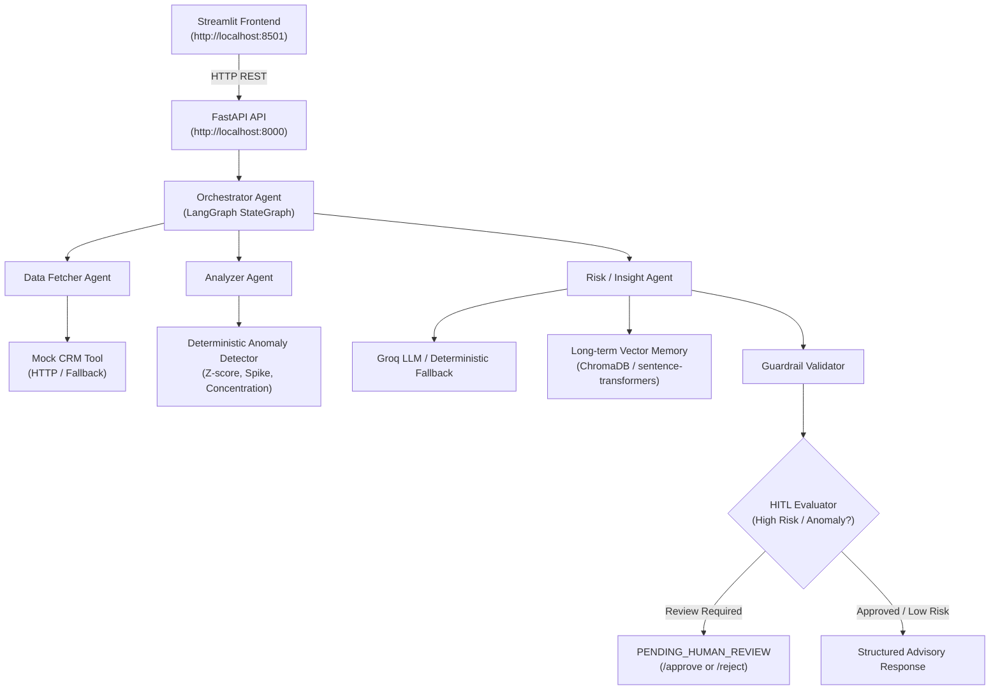

# Mini Multi-Agent Wealth Advisor Assistant

Production-quality, lightweight **multi-agent Wealth Advisor Assistant** built with Python 3.11+, FastAPI, LangGraph, Streamlit, Plotly, Pydantic, and ChromaDB / local sentence-transformers.

---

## 1. High-Level Architecture



---

## 2. Streamlit Dashboard Architecture (`streamlit_app/`)

The Streamlit frontend provides a monitoring & evaluation dashboard communicating **exclusively** with the FastAPI backend via `httpx`. **No agent logic or business calculations reside in Streamlit.**

```text
streamlit_app/
├── app.py                      # Main UI entrypoint with tabbed navigation
├── api_client.py               # HTTP client communicating with FastAPI
├── config.py                   # Frontend settings & API_BASE_URL
└── components/
    ├── dashboard.py            # KPI Cards, Plotly Pie & Bar Charts, Transaction Table
    ├── agent_trace.py          # LangGraph execution steps & node status trace
    ├── anomalies.py            # Detected anomaly matrix & severity badges
    ├── insights.py             # Advisory insights, recommendations & follow-up questions
    ├── hitl.py                 # Dedicated Human-in-the-Loop review & approval panel
    └── memory.py               # Client long-term vector memory inspector
```

### Streamlit Dashboard Features:
1. **Client Analysis Dashboard**: Displays KPI metrics (Income, Expenses, Net Cash Flow, Expense Ratio, Risk Tier), Plotly expenses-by-category donut chart, transaction breakdown bar chart, and transaction data tables.
2. **Agent Execution Trace**: Displays step-by-step LangGraph node execution (`✓ Orchestrator`, `✓ Data Fetcher`, `✓ CRM Tool`, `✓ Analyzer`, `✓ Anomaly Detector`, `✓ Insight Agent`, `✓ Validator`, `⚠ Human Review`) with statuses, latency, decisions, and expandable safe metadata.
3. **Anomaly Dashboard**: Displays flagged anomalies with severity indicators (`LOW`, `MEDIUM`, `HIGH`, `CRITICAL`), anomaly scores, types, and data-backed explanations.
4. **Advisory Insights**: Displays risk classification, executive summary, key findings, actionable recommendations with priority levels, and suggested follow-up questions.
5. **Human-in-the-Loop Review Gate**: Shows dedicated approval checkpoint when `requires_human_review = true` with `[ APPROVE ]` and `[ REJECT ]` controls that trigger FastAPI approval endpoints.
6. **Memory Viewer**: Allows evaluators to select client IDs and query historical advisory summaries retrieved from backend vector memory.

---

## 3. Agent Workflow & Boundaries

1. **Orchestrator Agent ([`app/agents/orchestrator.py`](file:///C:/Users/anike/.gemini/antigravity-ide/scratch/wealth-advisor-agent/app/agents/orchestrator.py))**: Manages execution flow through a LangGraph `StateGraph`. Tracks unique `request_id`, execution logs, and coordinates node state transitions.
2. **Data Fetcher Agent ([`app/agents/data_fetcher.py`](file:///C:/Users/anike/.gemini/antigravity-ide/scratch/wealth-advisor-agent/app/agents/data_fetcher.py))**: Validates client financial input schemas, fetches CRM context via `CRMTool` protocol, and handles CRM API failures gracefully in degraded mode.
3. **Analyzer Agent ([`app/agents/analyzer.py`](file:///C:/Users/anike/.gemini/antigravity-ide/scratch/wealth-advisor-agent/app/agents/analyzer.py))**: Calculates exact numerical metrics. **Zero LLM is used for math calculations.**
4. **Deterministic Anomaly Detector ([`app/tools/anomaly_detection.py`](file:///C:/Users/anike/.gemini/antigravity-ide/scratch/wealth-advisor-agent/app/tools/anomaly_detection.py))**: Implements statistical Z-score ($z \ge 2.5$), Spending Spike ratio ($1.5\times$ historical avg), and Category Concentration ($\ge 40\%$).
5. **Risk / Insight Agent ([`app/agents/insight_agent.py`](file:///C:/Users/anike/.gemini/antigravity-ide/scratch/wealth-advisor-agent/app/agents/insight_agent.py))**: Uses Groq (`llama-3.1-8b-instant`) to synthesize advisory insights with deterministic fallback.
6. **Guardrail Validator ([`app/agents/validator.py`](file:///C:/Users/anike/.gemini/antigravity-ide/scratch/wealth-advisor-agent/app/agents/validator.py))**: Inspects generated insights for compliance rules and schema sanity.

---

## 4. Port Reference & Execution Instructions

| Service | Address | Description |
| :--- | :--- | :--- |
| **Streamlit Dashboard** | `http://localhost:8501` | Interactive Frontend UI |
| **FastAPI Backend** | `http://localhost:8000` | Multi-Agent API & LangGraph Server |
| **Swagger OpenAPI Docs** | `http://localhost:8000/docs` | Interactive REST API Documentation |
| **Mock CRM Service** | `http://localhost:8001` | Simulated External CRM Service |

### Local Execution

```bash
# 1. Activate virtual environment
.venv\Scripts\activate

# 2. Run automated pytest suite
pytest

# 3. Start Backend API Server
uvicorn app.main:app --reload --port 8000

# 4. In a second terminal, start Streamlit Frontend
streamlit run streamlit_app/app.py --server.port 8501
```

### Docker Compose Execution

```bash
docker compose up --build
```
